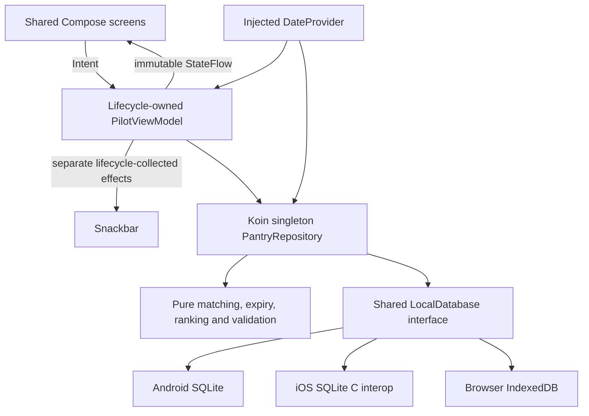

# PantryPilot

PantryPilot is a local-first Kotlin Multiplatform household pantry, recipe, purchase-order and stock-management app for Android, iOS and browsers. One Compose Material 3 UI, one repository and the same business rules serve all platforms. No backend, API keys, authentication or remote recipe images are required.

## Features

- Stock usage and waste recording, batch balances, quantity corrections, restocking and persistent stock history.
- Household purchase orders: draft, place, partial/full receipts and cancellation of outstanding quantities.
- Pantry create, edit and confirmed deletion; category, search and expiry filters; name/expiry sorting.
- Date-only expiry badges, dashboard summaries and use-first suggestions.
- User-created recipes with create/edit/delete, quantities, ordered instructions and optional bundled food photographs.
- Recipe search, can-cook and favorites filters; persistent favorites.
- Quantity shortfalls added atomically to a persistent shopping list, without duplicate active entries.
- Manual shopping CRUD, purchased status and confirmed purchased-item clearing.
- System, light and dark themes; empty first launch and confirmed local reset.
- Mobile bottom navigation including Orders, bounded desktop content, sidebar and responsive one-, two- or three-column recipe cards.

## Prerequisites and versions

Use JDK 21 (select it as the Gradle JDK in Android Studio), Android SDK 35, platform tools, and an Android device/emulator (minimum API 26). Gradle wrapper is 8.11. iOS needs macOS, Xcode and its command-line tools; supported targets are arm64 device, Apple Silicon simulator and Intel Mac simulator. Browser builds use Kotlin/JS, Node and Yarn provisioned by Gradle. Initial dependency downloads require network access.

| Dependency | Version |
| --- | --- |
| Kotlin / serialization compiler plugin | 2.1.20 |
| Compose Multiplatform | 1.8.0 |
| Material 3 | 1.8.0 |
| Android Gradle Plugin | 8.7.2 |
| AndroidX lifecycle multiplatform | 2.9.0-beta01 |
| Koin core / Compose | 4.0.2 |
| Coroutines / coroutines-test | 1.10.1 |
| Kotlin serialization JSON | 1.8.1 |
| kotlinx-datetime | 0.6.2 |

The build uses a coordinated Xcode 16.0-compatible Kotlin/Compose stack. Android compile/target SDK is 35, minimum SDK remains 26. The legacy Android library plugin supports Kotlin 2.1.20; aliases preserve the existing test commands. The JavaScript canvas target in Compose 1.8 requires the explicit org.jetbrains.compose.experimental.jscanvas.enabled opt-in. Navigation uses explicit immutable destination state and visible back actions instead of a navigation library.

## Build and run

PowerShell on Windows, from the project root:

```powershell
$env:JAVA_HOME = "$env:USERPROFILE\.gradle\jdks\azul_systems__inc_-21-amd64-windows.2"
$env:GRADLE_USER_HOME = "$env:USERPROFILE\.gradle"
.\gradlew.bat :androidApp:assembleDebug --no-configuration-cache
.\gradlew.bat :androidApp:installDebug --no-configuration-cache
.\gradlew.bat :webApp:jsBrowserDevelopmentRun --no-configuration-cache
.\gradlew.bat :webApp:jsBrowserProductionWebpack --no-configuration-cache
.\gradlew.bat :webApp:packageWebPreview --no-configuration-cache
node tools/preview.cjs
```

The packaged development web preview is in `webApp/build/dist/js/developmentExecutable`; `node tools/preview.cjs` serves it on localhost:8094. For production hosting use the standard `:webApp:jsBrowserDistribution` task and deploy its distribution directory. Production optimizations and hosting were not verified in this session.

Android APK: `androidApp/build/outputs/apk/debug/androidApp-debug.apk`. Launch PantryPilot from the device launcher after installation. Set `sdk.dir` in your untracked `local.properties` for your SDK location.

On macOS/Linux replace `.\gradlew.bat` with `./gradlew`. For iOS open `iosApp/iosApp.xcodeproj`, select your development team and simulator/device, then Run. The existing Xcode build phase builds the Shared framework. You can separately compile it on macOS with:

```sh
./gradlew :shared:linkDebugFrameworkIosSimulatorArm64
./gradlew :shared:iosSimulatorArm64Test
```

The web app uses the JavaScript browser target; the template's unused Wasm target was removed so there is one browser persistence adapter. Modern Chrome, Edge, Firefox or Safari with IndexedDB, WebAssembly (Skiko rendering), and canvas support are required. Serve via localhost or HTTPS with JavaScript and `.wasm` MIME types. Keep the scheme/host/port stable to retain the same database. No COOP/COEP or SQLite worker hosting is needed. Private browsing and storage restrictions can prevent persistent writes; errors are shown and unsaved forms retained. No service worker is included, so offline *launch* is not promised. After loading, pantry, recipes and shopping features do not request network content.

## Architecture



Packages under `shared/src/commonMain/kotlin/com/app/meal/planner` contain `core/model`, `core/database`, `core/di`, `core/designsystem`, `data/repository`, `domain`, and `feature`. `PilotViewModel` is the single owner for aggregate state, with immutable per-feature sub-states and explicit intents. Small features share one lifecycle-owned state holder so filters and selections survive tab changes. Flow observations publish database changes without manual UI reload. No business-rule mutations or database calls live in composables. State is read-only to consumers. A buffered channel handles one-time effects collected only while the lifecycle is started. Errors during initial loading are distinct from an empty database; retry is explicit. Cancellation is rethrown and save errors preserve editor fields.

A composition-scoped Koin application owns one database, repository and date provider. The feature holder is registered as a factory and retrieved through the lifecycle ViewModel store: it is retained for that owner and its coroutine scope is cancelled on clearing. There is no process-global service locator or second singleton. Feature state survives ordinary tab switches; editor and tab state are not promised after process death. Saved data does persist.

## Database design and platform boundaries

A shared database API and common serializable models provide consistent behavior. SQLite is native on Android and iOS. Browsers do not offer the same SQLite API, so IndexedDB is used behind the same interface rather than relying on unverified SQLite Wasm drivers. This is a real database on each platform, not preferences, localStorage or an in-memory persistence substitute.

SQLite schema version 1: `records(kind TEXT, id TEXT, payload TEXT, PRIMARY KEY(kind,id))`. Android uses application-private `pantry-pilot.db`; iOS uses its Documents directory and system sqlite3 through a declared cinterop. Each pantry and shopping item is a separate database row; favorite IDs, theme, purchase orders, stock movements and the stock-tracking migration marker are separate rows. A common RecordCodec maps every platform to the same row format. Existing balances gain opening-history entries exactly once during upgrade without resetting data. Payloads use Kotlin serialization. Browser database `PantryPilot`, version 1, uses the `records` object store keyed by `kind:id` with equivalent per-record fields. User recipe content is persisted as recipe rows through the same codec.

The repository serializes mutations with a Mutex. Each write commits the complete small local dataset in one SQLite transaction / IndexedDB readwrite transaction. UI state changes only after successful commit. Multi-ingredient additions are atomic. This deliberately favors correctness and simplicity for household-sized lists over incremental SQL queries. Browser write completion waits for transaction completion, not just individual request success. Reopen tests cover insert, update, purchased status, delete, favorites and theme. The database is not encrypted. Multi-tab simultaneous editing is not synchronized and may overwrite another tab's snapshot; use one active tab. Future work should add revision checks and incremental transactions before multi-tab collaboration.

Expiry uses the injected user's local date: before today is expired; today through today+3 inclusive is soon. Resume and a 30-second foreground timer refresh the date. Undated items remain available. Name matching trims, lowercases, collapses whitespace and applies a small explicit alias map. Expired ingredients are excluded. Overview cards and ranking use ingredient-name presence. Recipe details, Can cook, stock shortfalls and Cook & deduct stock check exact quantities and units without conversion. Confirmed cooking deducts from earliest-expiring unexpired batches atomically; viewing never consumes stock. Ranking prefers more soon-expiring ingredients, then fewer missing ingredients, then recipe ID. Shopping merge skips an existing active normalized name + unit, preserving quantity; other units and previously purchased entries are separate.

A fresh database starts empty. Existing installations retain their saved records. New personal entries, orders and stock history persist normally. The Load demo data action has been removed. Reset removes pantry, shopping, favorites, theme, orders and history.

## Verification

```powershell
.\gradlew.bat :shared:testAndroidHostTest --no-configuration-cache
$env:CHROME_BIN = 'C:\Program Files\Google\Chrome\Application\chrome.exe'
.\gradlew.bat :shared:jsBrowserTest --no-configuration-cache
.\gradlew.bat :shared:connectedAndroidDeviceTest --no-configuration-cache
```

Tests cover expiry boundaries, aliases, expired exclusion, deterministic ranking, idempotence and incompatible units, validation, recipe validation and user CRUD, repository failed writes, MVI validation/retry/save, and real database CRUD across close/reopen. iOS must be compiled and run on macOS before claiming it verified.

## Interview documents

The [project overview](document/PantryPilot%20Project%20Flow%20and%20Use%20Cases.docx) covers household workflows and platforms. The [interview guide](document/PantryPilot%20Project%20Interview%20Guide.docx) covers the implementation.

## Scope and future work

There is no authentication, cloud sync, remote recipe API, AI generation, scanner, notification, payments, full meal planning or automatic unit conversion. Future improvements: schema migrations after version 1, incremental writes, browser multi-tab conflict handling, export/import backups, router/history integration and a verified service worker for offline web launch. Android system Back returns through dialogs, recipe details and Home; the browser has equivalent back handling. Full deep links and forward-history restoration are future enhancements. iOS uses explicit app navigation and visible recipe back controls.


## Xcode 16.0 and photographs

Run `sh tools/verify-xcode16.sh` on your Mac with Xcode 16.0 selected. Recipe photos are committed under `shared/src/commonMain/composeResources/drawable`; source credits and license links are in `shared/PHOTO_CREDITS.md`. They are loaded from the app bundle/site, with no remote image URLs in the UI.


## User recipes and form updates

Recipes start empty and are created, edited and deleted by the user. Their ingredients, instructions and selected local photo persist in SQLite/IndexedDB through the common row codec. Deleting a recipe also removes its favorite marker and preserves stock history. Cooking and shopping-shortfall actions use saved recipes. The old catalog now exists only as test fixtures. Pantry and shopping also start empty on fresh installations.

Favorite controls are filled/outlined hearts with snackbar feedback. Empty states do not duplicate the screen add button. Scaffold handles system insets once; compact header/list spacing removes extra blank margins. Expiry entry uses Android DatePickerDialog, iOS UIDatePicker and browser-native date input, including receipt forms. Android disables app autofill integration without changing system-wide keyboard preferences.
